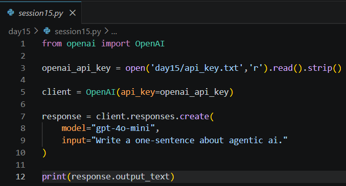
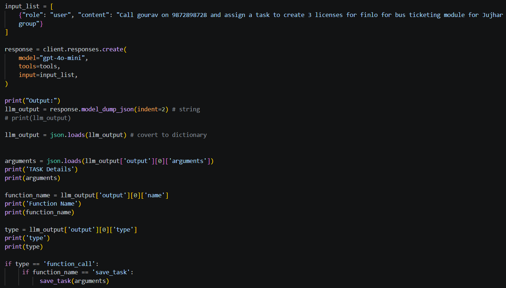
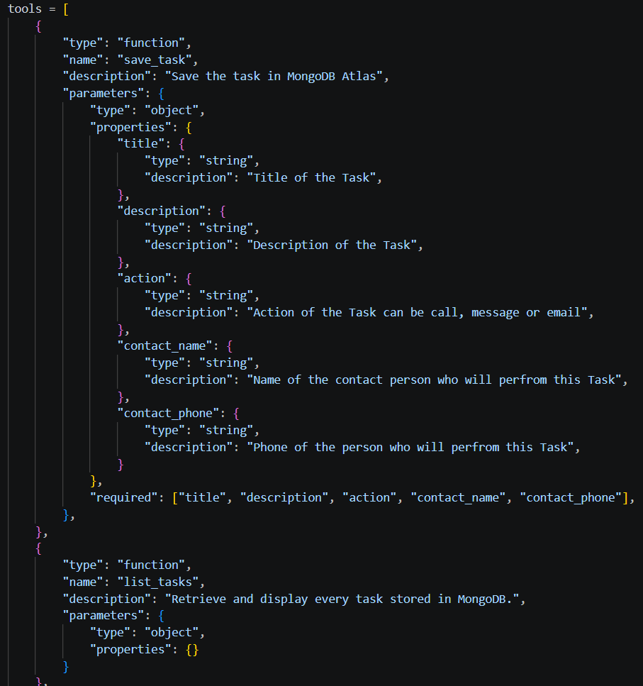
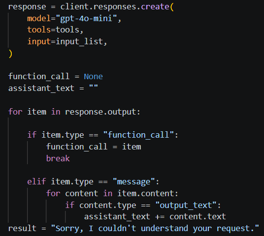
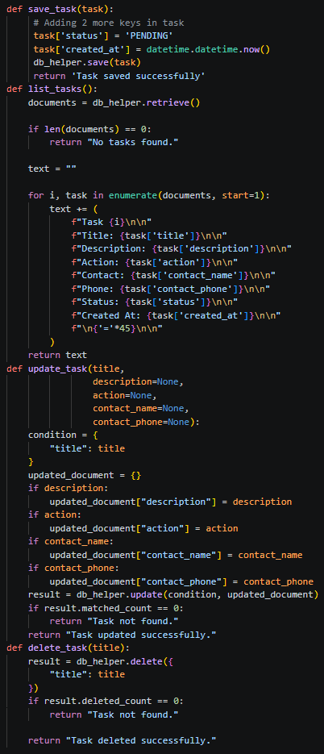
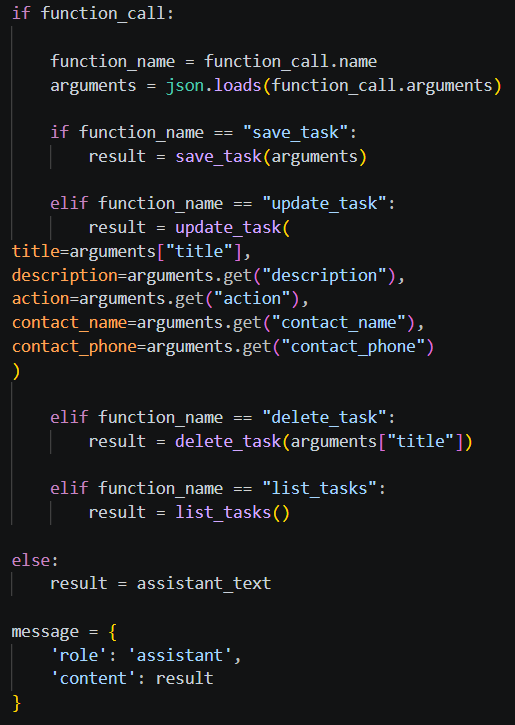
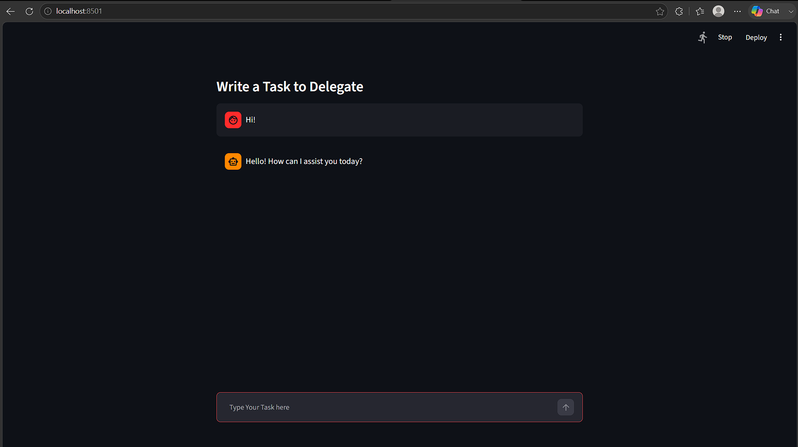

# Day 15 Notes

---

# From Commands to an AI Assistant

On Day 14 the chat bot understood only fixed commands such as `create task: ...`. It split the text and matched keywords.

Today the user can simply write:

```
Call gourav on 9872898728 and assign a task to create 3 licenses
for finlo for bus ticketing module for Jujhar group
```

and the program works out the rest.

```
User message
     |
     v
  LLM (OpenAI)  --- knows the list of tools ---
     |
     |  "call save_task with these arguments"
     v
Python function  ->  MongoDB
     |
     v
Reply shown in chat
```

---

# OpenAI Responses API

```python
from openai import OpenAI

openai_api_key = open('api_key.txt', 'r').read().strip()
client = OpenAI(api_key=openai_api_key)

response = client.responses.create(
    model="gpt-4o-mini",
    input="Write a one-sentence about agentic ai."
)

print(response.output_text)
```

- The API key is read from a separate file and `strip()` removes the extra newline.
- `OpenAI(api_key=...)` creates the client.
- `client.responses.create()` sends the prompt to the model.
- `response.output_text` is the text answer.

> Keep `api_key.txt` out of GitHub by adding it to `.gitignore`.



---

# Function Calling

Normally an LLM only produces text. With function calling we **describe our Python functions** to the model, and it replies with *which function to call and with what arguments*.



### Steps

1. Write the Python function.
2. Describe it in a **tool schema**.
3. Send the user message together with the `tools` list.
4. Read the function name and arguments from the response.
5. Run the function yourself.

The model never runs the function. It only **decides**. Our code executes it.

---

# Tool Schema

```python
tools = [
    {
        "type": "function",
        "name": "save_task",
        "description": "Save the task in MongoDB Atlas",
        "parameters": {
            "type": "object",
            "properties": {
                "title":         {"type": "string", "description": "Title of the Task"},
                "description":   {"type": "string", "description": "Description of the Task"},
                "action":        {"type": "string", "description": "Action of the Task can be call, message or email"},
                "contact_name":  {"type": "string", "description": "Name of the contact person who will perform this task"},
                "contact_phone": {"type": "string", "description": "Phone of the contact person who will perform this task"}
            },
            "required": ["title", "description", "action", "contact_name", "contact_phone"],
        },
    },
]
```

| Part | Meaning |
|------|---------|
| `type` | Always `"function"` |
| `name` | Must match the Python function name |
| `description` | Tells the model **when** to use this tool |
| `properties` | The arguments, each with a type and description |
| `required` | Arguments the model must always provide |



---

# Reading the Model's Decision

```python
response = client.responses.create(
    model="gpt-4o-mini",
    tools=tools,
    input=input_list,
)

llm_output = json.loads(response.model_dump_json(indent=2))

arguments     = json.loads(llm_output['output'][0]['arguments'])
function_name = llm_output['output'][0]['name']
type          = llm_output['output'][0]['type']

if type == 'function_call':
    if function_name == 'save_task':
        save_task(arguments)
```

| Field | Example |
|-------|---------|
| `type` | `function_call` |
| `name` | `save_task` |
| `arguments` | `'{"title": "...", "contact_name": "gourav", ...}'` (a **string**) |

`arguments` is JSON text, so `json.loads()` is needed to turn it into a dictionary (same idea as Day 11).



### Two kinds of output items

| `item.type` | Meaning |
|-------------|---------|
| `function_call` | The model wants a function to run |
| `message` | The model replied with normal text; read `content[].text` |

---

# Four Tools for CRUD

| Tool | Does | Required Arguments |
|------|------|--------------------|
| `save_task` | Create a task | title, description, action, contact_name, contact_phone |
| `list_tasks` | Show all tasks | none |
| `update_task` | Change fields of a task | title (others optional) |
| `delete_task` | Delete a task | title |



### Backend functions

```python
def save_task(task):
    task['status'] = 'PENDING'
    task['created_at'] = datetime.datetime.now()
    db_helper.save(task)
    return 'Task saved successfully'
```

- Two extra keys, `status` and `created_at`, are added **by the program**, not by the model.

```python
def update_task(title, description=None, action=None,
                contact_name=None, contact_phone=None):
    condition = {"title": title}
    updated_document = {}
    if description:   updated_document["description"] = description
    if action:        updated_document["action"] = action
    ...
    result = db_helper.update(condition, updated_document)
    if result.matched_count == 0:
        return "Task not found."
    return "Task updated successfully."
```

- Only the fields the user mentioned are sent to `$set`, so the other fields are left unchanged.
- `matched_count` tells whether a task with that title existed.

```python
def delete_task(title):
    result = db_helper.delete({"title": title})
    if result.deleted_count == 0:
        return "Task not found."
    return "Task deleted successfully."
```

---

# Executing the Chosen Function

```python
if function_call:
    function_name = function_call.name
    arguments = json.loads(function_call.arguments)

    if function_name == "save_task":
        result = save_task(arguments)
    elif function_name == "update_task":
        result = update_task(title=arguments["title"],
                             description=arguments.get("description"), ...)
    elif function_name == "delete_task":
        result = delete_task(arguments["title"])
    elif function_name == "list_tasks":
        result = list_tasks()
else:
    result = assistant_text
```

- `arguments["title"]` is used for required values.
- `arguments.get("description")` is used for optional values, because `.get()` returns `None` instead of crashing when a key is missing.
- If no function was chosen, the model's own text is shown.



---

# Chat Interface with AI

```python
@st.cache_resource
def get_db():
    db = DBHelper()
    db.select_collection("tasks")
    return db
db_helper = get_db()
```

- `@st.cache_resource` creates the database connection **once** and reuses it across Streamlit re-runs, instead of reconnecting on every message.
- `st.session_state.messages` keeps the chat history, and the typing effect (`st.empty()` and `time.sleep()`) shows the reply character by character, as on Day 14.
- `DBHelper` was updated: `retrieve()` now returns `list(...)` and `update()` / `delete()` return the result object so the app can check `matched_count` and `deleted_count`.



---

# Things to Revisit

- Each message is sent **alone** (`input_list` has only the latest message), so the model does not remember earlier messages in the conversation.
- Titles are used to find tasks, so two tasks with the same title cannot be told apart.
- Keep `api_key.txt` and database credentials out of the repository.

---

# Summary

Today's session replaced manual command parsing with OpenAI Function Calling. The model chooses the tool and arguments, Python executes the function on MongoDB, and the Streamlit chat shows the result, which gives a complete CRUD assistant that understands natural language.
