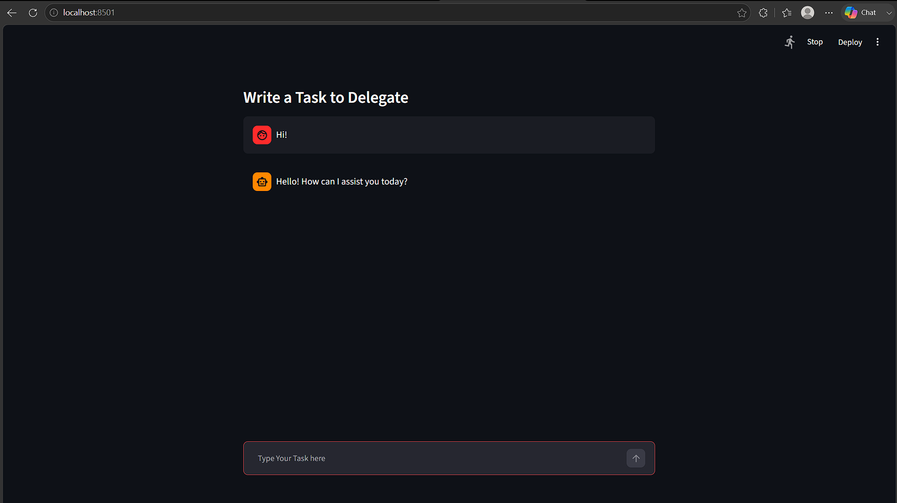
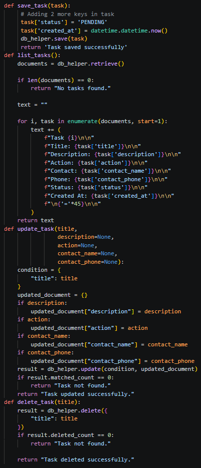

# Day 15 Assignment - Upgrade the Chat UI to an AI Agent

## 🎯 Objective

No separate assignment was given for this session. The practical task was to upgrade the Day 14 chat application so that all CRUD operations work through natural language using OpenAI Function Calling.

---

# 📝 Problem Statement

Take the Day 14 task manager and replace its manual command parsing with an AI model that:

- Understands the user's request in plain language.
- Chooses the right backend function (create, list, update, delete).
- Produces the arguments for that function.
- Shows the result inside the Streamlit chat.

---

# 💡 Approach

- Create an OpenAI client with `client.responses.create()` and the `gpt-4o-mini` model.
- Describe `save_task`, `list_tasks`, `update_task` and `delete_task` as tools using JSON schemas.
- Send every user message to the model along with the tools.
- Read the `function_call` item from the response and parse its arguments with `json.loads()`.
- Run the matching Python function, which uses `DBHelper` to work on MongoDB.
- Show the returned text with the typing effect.
- Print and inspect the raw response to understand its structure.

---

# 🧠 Concepts Applied

- OpenAI Responses API
- Function Calling (Tools)
- JSON Tool Schemas
- Parsing JSON Arguments
- MongoDB CRUD through `DBHelper`
- Streamlit Chat Components and Session State
- `@st.cache_resource`

---

# 📂 Logic

```
Show previous chat messages

Wait for user input

Send message + tools to the model

If the model returns a function_call

    Read function name and arguments

    save_task    -> add status PENDING and created_at, insert
    list_tasks   -> read all tasks and format them
    update_task  -> $set only the given fields
    delete_task  -> delete by title

Else

    Show the model's normal text reply

Display the reply in the chat
```

---

# 📷 Output





---

# 📚 Learning Outcome

Through this assignment, I learned:

- How an LLM can act as the decision-making layer of an application.
- How tool schemas tell the model what the application can do.
- How to connect the model's decision to real database operations.
- How much simpler the application becomes without manual parsing.

---

# 🚀 Skills Practiced

- AI Application Development
- API Integration
- Database Operations
- Python Fundamentals
- Problem Solving

---

# 📌 Conclusion

This task turned a rule-based chat into an agentic assistant. The model reasons about the request while Python functions perform the work, which is the basic pattern used in real AI agents.
