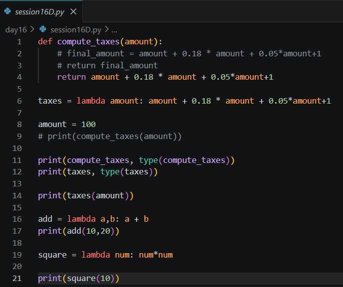
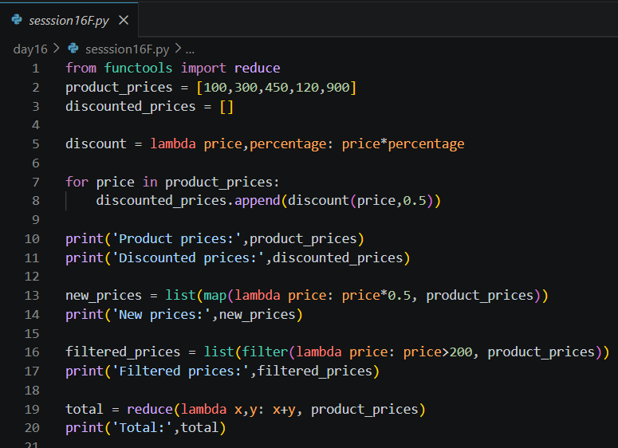
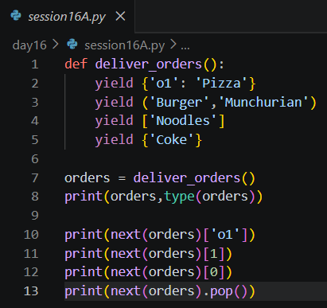
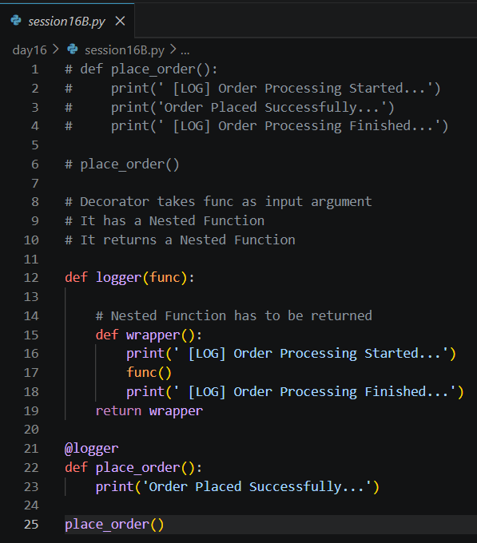
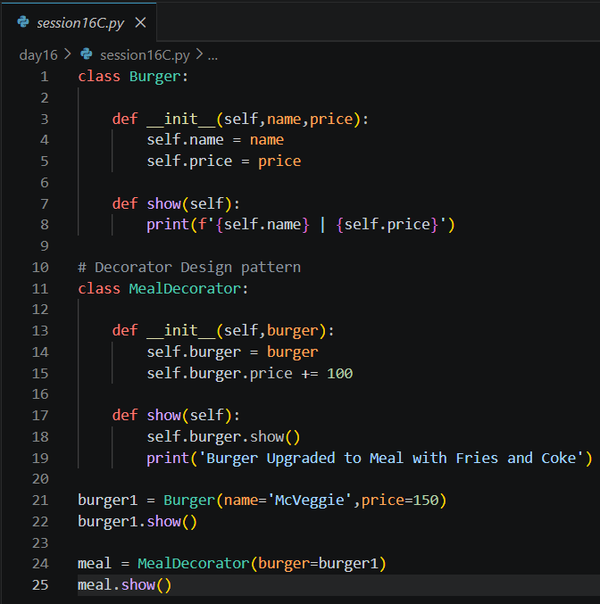
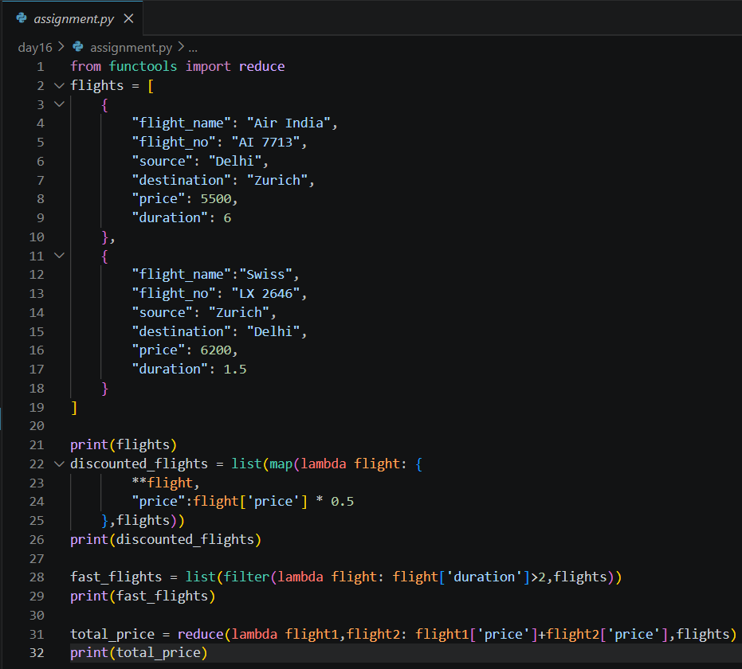

# Day 16 Notes

---

# Lambda Functions

A **lambda** is a small anonymous function written in one line.

```python
def compute_taxes(amount):
    return amount + 0.18 * amount + 0.05 * amount + 1

taxes = lambda amount: amount + 0.18 * amount + 0.05 * amount + 1

print(compute_taxes, type(compute_taxes))   # <function ...> <class 'function'>
print(taxes, type(taxes))                   # same type
print(taxes(100))
```

Both versions are functions of the same type. The lambda just avoids `def` and `return`.

### Syntax

```
lambda arguments : expression
```

```python
add = lambda a, b: a + b
print(add(10, 20))        # 30

square = lambda num: num * num
print(square(10))         # 100
```

- The expression's value is returned automatically.
- Only a **single expression** is allowed, not several statements.

---

# Functions Returning Functions

```python
discount_generator = lambda discount: (lambda price: price - (price * discount / 100))

monthly_subscription     = discount_generator(10)
half_yearly_subscription = discount_generator(20)
yearly_subscription      = discount_generator(30)

print(monthly_subscription(1000))        # 900.0
print(half_yearly_subscription(1000))    # 800.0
print(yearly_subscription(1000))         # 700.0
```

- The outer lambda receives the discount and **returns another lambda**.
- Each returned lambda remembers its own discount.
- This shows that functions are values in Python.



---

# map(), filter() and reduce()

They are **higher-order functions**: they take another function as an argument.

```python
from functools import reduce

product_prices = [100, 300, 450, 120, 900]

new_prices = list(map(lambda price: price * 0.5, product_prices))
filtered_prices = list(filter(lambda price: price > 200, product_prices))
total = reduce(lambda x, y: x + y, product_prices)
```

| Function | Does | Result |
|----------|------|--------|
| `map(func, data)` | Applies `func` to **every** element | `[50.0, 150.0, 225.0, 60.0, 450.0]` |
| `filter(func, data)` | Keeps elements where `func` is `True` | `[300, 450, 900]` |
| `reduce(func, data)` | Combines all elements into **one** value | `1870` |

- `map` and `filter` return iterator objects, so `list()` is used to see the values.
- `reduce` must be imported from `functools`.
- Compared with a `for` loop and `append()`, these are shorter and easier to read.



---

# Iterators

Any iterable (list, set, tuple, string, dictionary) can give an **iterator**.

```python
orders = {'o1': 'Pizza', 'o2': 'Burger', 'o3': 'Pasta', 'o4': 'Noodles', 'o5': 'Coke'}

orders_iterator = iter(orders)
print(orders_iterator, type(orders_iterator))

print(next(orders_iterator))   # o1
print(next(orders_iterator))   # o2
```

- `iter()` creates the iterator.
- `next()` returns the next item each time it is called.
- For a dictionary, iterating gives the **keys**.
- When the items finish, `next()` raises `StopIteration`. A `for` loop uses the same mechanism internally and stops quietly.

---

# Generators

A **generator function** uses `yield` instead of `return`.

```python
def deliver_orders():
    yield {'o1': 'Pizza'}
    yield ('Burger', 'Munchurian')
    yield ['Noodles']
    yield {'Coke'}

orders = deliver_orders()
print(orders, type(orders))          # <generator object ...>

print(next(orders)['o1'])            # Pizza
print(next(orders)[1])               # Munchurian
print(next(orders)[0])               # Noodles
print(next(orders).pop())            # Coke
```

| `return` | `yield` |
|----------|---------|
| Ends the function | **Pauses** the function and remembers where it stopped |
| Gives one value | Gives one value per `next()` call |

- Calling the function does not run it; it returns a generator object.
- Values are produced **lazily**, so a huge or endless stream can be processed without storing it all in memory.



---

# Function Decorators

A **decorator** adds extra behaviour around a function without changing the function itself.

```python
def logger(func):

    def wrapper():
        print(' [LOG] Order Processing Started...')
        func()
        print(' [LOG] Order Processing Finished...')
    return wrapper

@logger
def place_order():
    print('Order Placed Successfully...')

place_order()
```

**Output**

```
 [LOG] Order Processing Started...
Order Placed Successfully...
 [LOG] Order Processing Finished...
```

### Rules

- The decorator **takes a function** as its argument.
- It has a **nested function** (`wrapper`).
- It **returns the nested function**.
- `@logger` above `place_order` is the same as `place_order = logger(place_order)`.

Common uses: logging, authentication, timing, error handling.



---

# Decorator Design Pattern

The same idea applied to **objects** using classes.

```python
class Burger:
    def __init__(self, name, price):
        self.name = name
        self.price = price

    def show(self):
        print(f'{self.name} | {self.price}')


class MealDecorator:
    def __init__(self, burger):
        self.burger = burger
        self.burger.price += 100

    def show(self):
        self.burger.show()
        print('Burger Upgraded to Meal with Fries and Coke')


burger1 = Burger(name='McVeggie', price=150)
burger1.show()

meal = MealDecorator(burger=burger1)
meal.show()
```

**Output**

```
McVeggie | 150
McVeggie | 250
Burger Upgraded to Meal with Fries and Coke
```

- `MealDecorator` **wraps** a `Burger` (composition, as on Day 10).
- It adds ₹100 and extra output, but the `Burger` class is not edited.
- Note that the wrapped burger's own price is also changed, since it is the same object.



---

# Assignment - Flights with Map, Filter and Reduce

A list of flight dictionaries was processed using lambdas.

```python
from functools import reduce

flights = [
    {"flight_name": "Air India", "flight_no": "AI 7713", "source": "Delhi",
     "destination": "Zurich", "price": 5500, "duration": 6},
    {"flight_name": "Swiss", "flight_no": "LX 2646", "source": "Zurich",
     "destination": "Delhi", "price": 6200, "duration": 1.5},
]

discounted_flights = list(map(lambda flight: {**flight, "price": flight['price'] * 0.5}, flights))
long_flights = list(filter(lambda flight: flight['duration'] > 2, flights))
total_price = reduce(lambda total, flight: total + flight['price'], flights, 0)
```

- `{**flight, "price": ...}` copies all keys of the dictionary and replaces only `price`, so the original data is not changed.
- `filter` keeps only the flights whose duration is more than 2 hours.
- `reduce` with a starting value `0` adds up the prices.

### Common mistake in `reduce`

```python
reduce(lambda f1, f2: f1['price'] + f2['price'], flights)
```

This works only when there are exactly **two** items. After the first step the running total is a number, and `number['price']` fails for a third item. Using `total + flight['price']` with an initial value of `0` works for any number of flights.



---

# Summary

Today's session focused on lambda functions, `map` / `filter` / `reduce`, iterators and generators, and two forms of decorators, which help in writing shorter, reusable and memory-efficient Python code.
