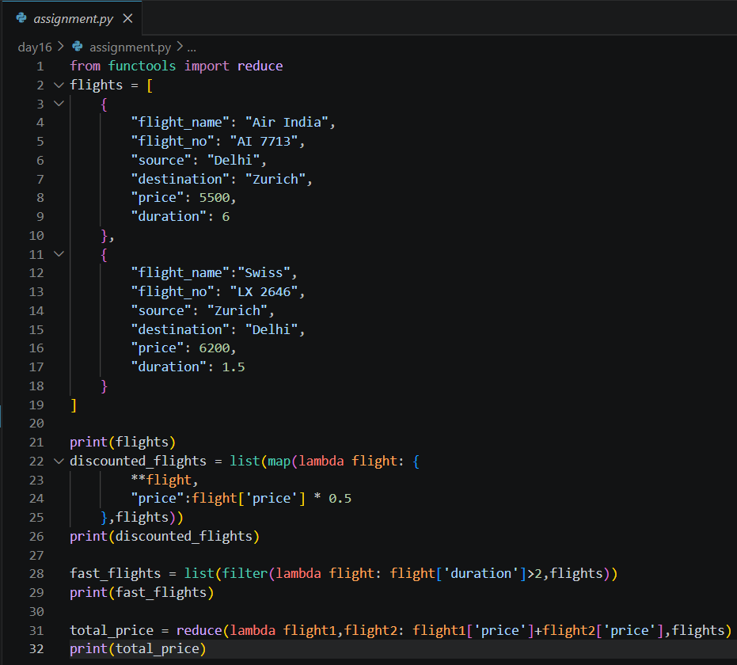

# Day 16 Assignment - Flight Records using Map, Filter and Reduce

## 🎯 Objective

The objective of this assignment was to apply functional programming concepts to structured data represented as a list of dictionaries.

---

# 📝 Problem Statement

A list of flights is given, where every flight has a name, number, source, destination, price and duration.

Using lambda expressions:

- Use `map()` to give a **50% discount** on every flight's price.
- Use `filter()` to select the flights that satisfy a **duration condition**.
- Use `reduce()` to calculate the **total price** of all flights.

---

# 💡 Approach

- Import `reduce` from `functools`.
- With `map()`, build a new dictionary for every flight using `{**flight, "price": flight['price'] * 0.5}`, so all other details are kept and only the price changes.
- With `filter()`, keep flights where `duration > 2`.
- With `reduce()`, add the prices, starting from `0` so the code works for any number of flights.
- Wrap `map()` and `filter()` results in `list()` and print them.

---

# 🧠 Concepts Applied

- Lambda Functions
- `map()`, `filter()` and `reduce()`
- Dictionary Unpacking (`**`)
- Lists of Dictionaries
- Higher-Order Functions

---

# 📂 Logic

```
flights = list of dictionaries

discounted = map    -> same flight, price * 0.5
selected   = filter -> flights with duration > 2
total      = reduce -> sum of all prices

Print flights, discounted, selected and total
```

---

# 📷 Output



---

# 📚 Learning Outcome

Through this assignment, I learned:

- Transforming, filtering and combining data without writing loops.
- Creating a modified copy of a dictionary without changing the original.
- Why `reduce` needs a sensible running total (and an initial value).
- How these tools apply to real records rather than plain numbers.

---

# 🚀 Skills Practiced

- Functional Programming
- Data Processing
- Working with Dictionaries
- Problem Solving
- Python Fundamentals

---

# 📌 Conclusion

The assignment showed that `map`, `filter` and `reduce` can process structured data in a few readable lines, and prepared the ground for processing larger datasets in later sessions.
