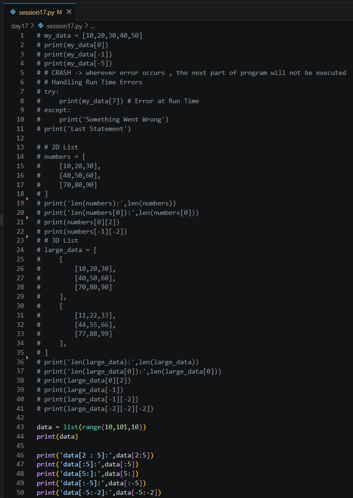
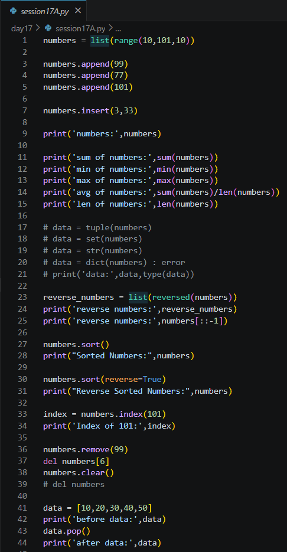
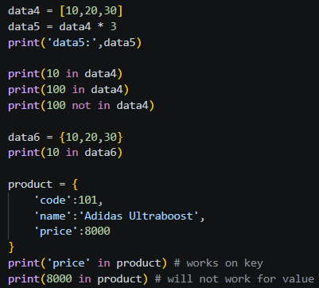
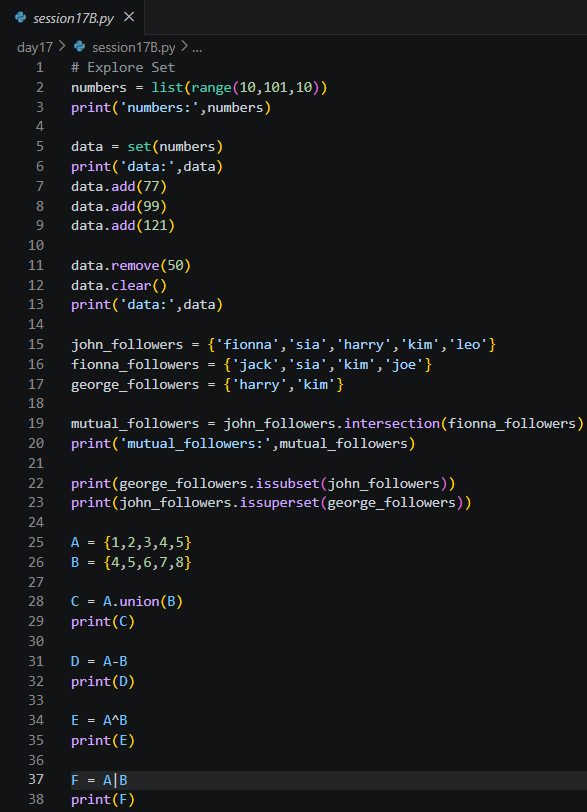
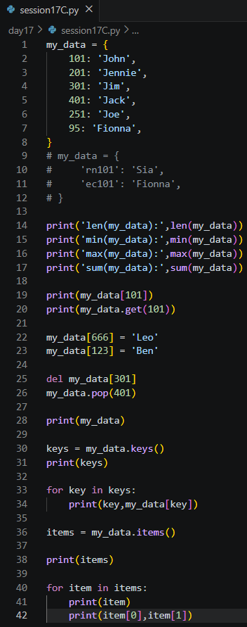
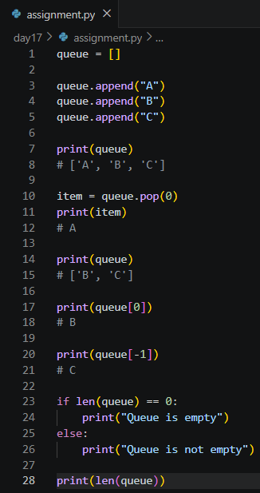

# Day 17 Notes

---

# Exception Handling

A **runtime error** happens while the program is running, for example using an index that does not exist. Without handling, the program **crashes** and the remaining code never runs.

```python
my_data = [10, 20, 30, 40, 50]

try:
    print(my_data[7])        # IndexError at run time
except:
    print('Something Went Wrong')

print('Last Statement')      # still runs
```

- Code that may fail goes in `try`.
- If an error occurs, Python jumps to `except`.
- The program then continues with the next statement.

---

# Multi-Dimensional Lists

```python
numbers = [
    [10, 20, 30],
    [40, 50, 60],
    [70, 80, 90]
]

print(len(numbers))        # 3  (rows)
print(len(numbers[0]))     # 3  (columns)
print(numbers[0][2])       # 30
print(numbers[-1][-2])     # 80
```

- A **2D list** is a list of lists: the first index selects the row, the second selects the item inside it.
- A **3D list** adds one more level, so three indexes are needed, e.g. `large_data[-2][-2][-2]`.

---

# List Slicing

```python
data = list(range(10, 101, 10))     # [10, 20, ..., 100]

print(data[2:5])      # [30, 40, 50]
print(data[:5])       # [10, 20, 30, 40, 50]
print(data[5:])       # [60, 70, 80, 90, 100]
print(data[:-5])      # [10, 20, 30, 40, 50]
print(data[-5:-2])    # [60, 70, 80]
```

- `start` is included and `stop` is **excluded**.
- A missing `start` means from the beginning, a missing `stop` means up to the end.
- Negative numbers count from the end.



### Joining and Repeating

```python
data1 = [10, 20, 30]
data2 = [40, 50, 60]
print(data1 + data2)       # [10, 20, 30, 40, 50, 60]
print(data1 * 3)           # [10, 20, 30, 10, 20, 30, 10, 20, 30]
```

---

# List Operations

```python
numbers = list(range(10, 101, 10))

numbers.append(99)          # add at the end
numbers.insert(3, 33)       # add 33 at index 3

print(sum(numbers), min(numbers), max(numbers), len(numbers))
print(sum(numbers) / len(numbers))      # average
```

| Operation | Method / Function |
|-----------|-------------------|
| Add at the end | `append(x)` |
| Add at a position | `insert(index, x)` |
| Total, smallest, largest, count | `sum()`, `min()`, `max()`, `len()` |
| Reverse (new list) | `list(reversed(numbers))` or `numbers[::-1]` |
| Sort ascending | `numbers.sort()` |
| Sort descending | `numbers.sort(reverse=True)` |
| Find position | `numbers.index(101)` |
| Remove by value | `numbers.remove(99)` |
| Remove by index | `del numbers[6]` |
| Remove last item | `numbers.pop()` |
| Remove everything | `numbers.clear()` |
| Delete the list itself | `del numbers` |

A list can also be converted to another type: `tuple(numbers)`, `set(numbers)`, `str(numbers)`. `dict(numbers)` gives an error because a dictionary needs key-value pairs.



---

# Membership Operators

```python
data4 = [10, 20, 30]
print(10 in data4)           # True
print(100 not in data4)      # True

data6 = {10, 20, 30}
print(10 in data6)           # True

product = {'code': 101, 'name': 'Adidas Ultraboost', 'price': 8000}
print('price' in product)    # True   (checks the KEY)
print(8000 in product)       # False  (values are not checked)
```

| Collection | `in` checks |
|------------|-------------|
| List | Values |
| Set | Values |
| Dictionary | **Keys** |

To search the values of a dictionary use `8000 in product.values()`.



---

# Sets

A **set** stores only **unique** elements and has no index order.

```python
numbers = list(range(10, 101, 10))
data = set(numbers)

data.add(77)
data.add(121)
data.remove(50)
data.clear()
```

- Adding a value that already exists changes nothing.
- Converting a list to a set is a quick way to **remove duplicates**.

### Social Media Followers Example

```python
john_followers   = {'fionna', 'sia', 'harry', 'kim', 'leo'}
fionna_followers = {'jack', 'sia', 'kim', 'joe'}
george_followers = {'harry', 'kim'}

mutual_followers = john_followers.intersection(fionna_followers)   # {'sia', 'kim'}

print(george_followers.issubset(john_followers))      # True
print(john_followers.issuperset(george_followers))    # True
```

### Mathematical Operations

```python
A = {1, 2, 3, 4, 5}
B = {4, 5, 6, 7, 8}
```

| Operation | Method | Operator | Result |
|-----------|--------|----------|--------|
| Union | `A.union(B)` | `A \| B` | `{1, 2, 3, 4, 5, 6, 7, 8}` |
| Intersection | `A.intersection(B)` | `A & B` | `{4, 5}` |
| Difference | `A.difference(B)` | `A - B` | `{1, 2, 3}` |
| Symmetric difference | `A.symmetric_difference(B)` | `A ^ B` | `{1, 2, 3, 6, 7, 8}` |

- Subset: every element of one set is in the other.
- Superset: the opposite relation.



---

# Dictionaries

```python
my_data = {
    101: 'John',
    201: 'Jennie',
    301: 'Jim',
    401: 'Jack',
    251: 'Joe',
    95: 'Fionna',
}
```

### Reading

```python
print(my_data[101])         # John
print(my_data.get(101))     # John
```

- `my_data[key]` raises an error if the key is missing.
- `my_data.get(key)` returns `None` instead, so it is safer.

### Built-in Functions work on the Keys

```python
print(len(my_data))     # 6
print(min(my_data))     # 95
print(max(my_data))     # 401
print(sum(my_data))     # sum of the keys
```

### Adding, Updating and Deleting

```python
my_data[666] = 'Leo'      # new key  -> adds
my_data[123] = 'Ben'
my_data[666] = 'Leon'     # existing key -> updates

del my_data[301]          # remove by key
my_data.pop(401)          # remove by key and return the value
```

### Looping

```python
keys = my_data.keys()
for key in keys:
    print(key, my_data[key])

for item in my_data.items():
    print(item[0], item[1])        # (key, value) pair as a tuple
```

| Method | Returns |
|--------|---------|
| `keys()` | All keys |
| `values()` | All values |
| `items()` | All `(key, value)` pairs |



---

# Assignment - Queue using a List

A **queue** follows **FIFO** (First In, First Out), like people standing in a line.

```python
queue = []

queue.append("A")        # enqueue
queue.append("B")
queue.append("C")
print(queue)             # ['A', 'B', 'C']

item = queue.pop(0)      # dequeue (removes from the front)
print(item)              # A
print(queue)             # ['B', 'C']

print(queue[0])          # B  -> front
print(queue[-1])         # C  -> rear

if len(queue) == 0:
    print("Queue is empty")
else:
    print("Queue is not empty")
```

| Queue Operation | List Code |
|-----------------|-----------|
| Enqueue | `queue.append(item)` |
| Dequeue | `queue.pop(0)` |
| Front | `queue[0]` |
| Rear | `queue[-1]` |
| Is empty? | `len(queue) == 0` |
| Size | `len(queue)` |

- `pop(0)` must shift all other elements, so it is slow for large queues. `collections.deque` with `popleft()` is the efficient choice in real programs.
- Compare this with the circular queue built on Day 10.



---

# Summary

Today's session focused on exception handling, list slicing and operations, membership checks, set mathematics, dictionary handling, and implementing a FIFO queue using a list.
