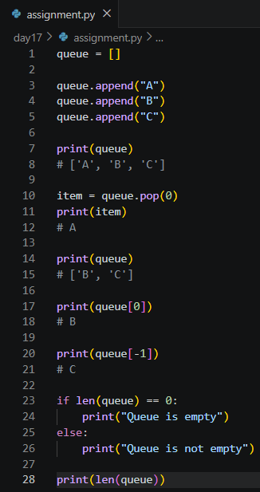

# Day 17 Assignment - Queue Implementation using a List

## 🎯 Objective

The objective of this assignment was to simulate a queue using a Python list while following the First-In, First-Out (FIFO) principle.

---

# 📝 Problem Statement

Explore the implementation of a **Queue** using a Python list.

- Insert elements at one end (the rear).
- Remove elements from the other end (the front).
- Make sure the elements leave in the same order in which they entered.

---

# 💡 Approach

- Start with an empty list.
- **Enqueue** by adding elements with `append()`.
- **Dequeue** by removing the first element with `pop(0)`.
- Read the front with `queue[0]` and the rear with `queue[-1]`.
- Check emptiness and size with `len()`.
- Print the queue after every operation to confirm the behaviour.

---

# 🧠 Concepts Applied

- Lists
- `append()` and `pop(0)`
- Indexing and Negative Indexing
- FIFO Principle
- Conditional Statements

---

# 📂 Logic

```
queue = []

Enqueue A, B, C        -> ['A', 'B', 'C']

Dequeue                -> removes A, queue is ['B', 'C']

Front   = queue[0]     -> B
Rear    = queue[-1]    -> C

If len(queue) == 0
    Queue is empty
Else
    Queue is not empty

Print size
```

---

# 📷 Output



---

# 📚 Learning Outcome

Through this assignment, I learned:

- How a queue works and why FIFO order matters.
- How list methods map to queue operations.
- That `pop(0)` is simple but slow on large lists, and that `collections.deque` is the better tool in production.
- How this relates to the circular queue built earlier in the training.

---

# 🚀 Skills Practiced

- Data Structures
- Python Lists
- Logical Thinking
- Problem Solving

---

# 📌 Conclusion

This assignment connected a classical data structure with Python's built-in list. It showed how a few list methods are enough to model queue behaviour.
