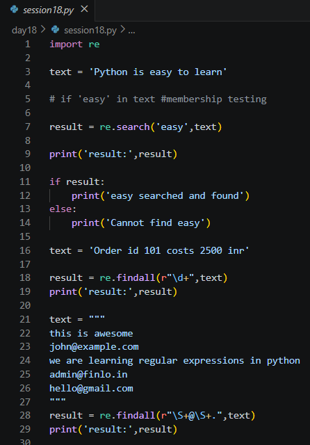
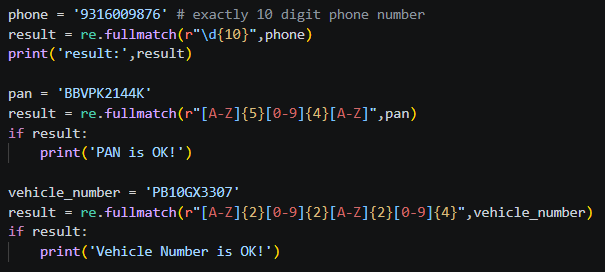
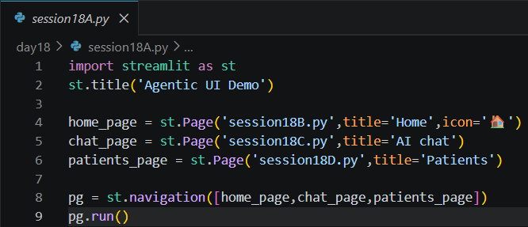
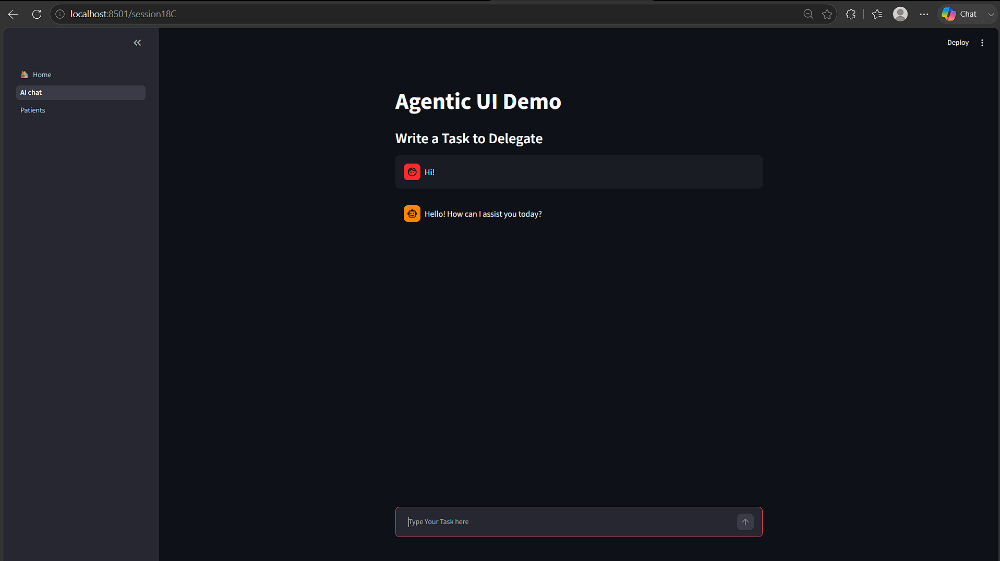
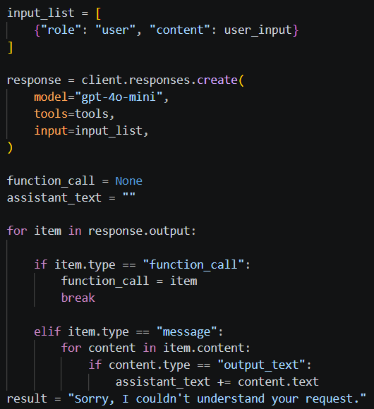
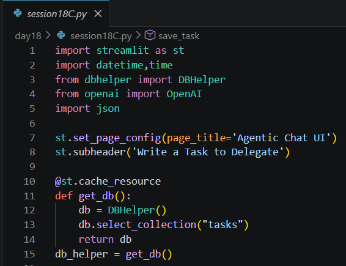
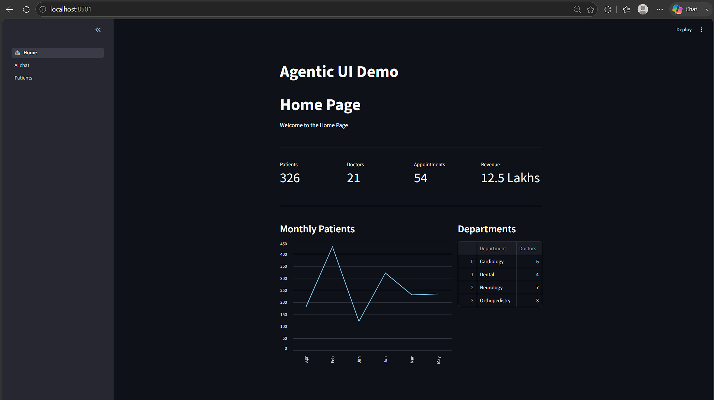

# Day 18 Notes

---

# Regular Expressions (Regex)

A **regular expression** is a pattern that describes a kind of text. Python's `re` module uses it to search, extract and validate strings.

```python
import re
```

## re.search()

Finds the **first** place where the pattern occurs. Returns a match object, or `None` if not found.

```python
text = 'Python is easy to learn'

result = re.search('easy', text)
if result:
    print('easy searched and found')
else:
    print('Cannot find easy')
```

Plain words can be found with `in`, but `search` also works with patterns.

---

## re.findall()

Returns a **list of all matches**.

```python
text = 'Order id 101 costs 2500 inr'
print(re.findall(r"\d+", text))        # ['101', '2500']
```

- `\d` means a digit and `+` means one or more.
- The `r` before the quotes makes it a **raw string**, so `\d` is not treated as an escape character.

### Finding emails

```python
text = """
this is awesome
john@example.com
we are learning regular expressions in python
admin@finlo.in
hello@gmail.com
"""
print(re.findall(r"\S+@\S+", text))
```

- `\S` means any character that is not a space.
- `\S+@\S+` means some characters, then `@`, then some characters.

---

## re.fullmatch()

Checks whether the **entire** string matches the pattern. Used for **validation**.

```python
phone = '9316009876'
print(re.fullmatch(r"\d{10}", phone))      # match object -> valid
```

- `{10}` means exactly 10 times.

---

# Common Pattern Symbols

| Symbol | Meaning |
|--------|---------|
| `\d` | A digit (0-9) |
| `\S` | A non-space character |
| `.` | Any character (use `\.` for a real dot) |
| `[A-Z]` | One capital letter |
| `[0-9]` | One digit |
| `+` | One or more times |
| `{n}` | Exactly n times |
| `\|` | OR between patterns |



---

# Validation Examples

### PAN Card (5 letters + 4 digits + 1 letter)

```python
pan = 'BBVPK2144K'
if re.fullmatch(r"[A-Z]{5}[0-9]{4}[A-Z]", pan):
    print('PAN is OK!')
```

### Vehicle Registration Number (e.g. PB10GX3307)

```python
vehicle_number = 'PB10GX3307'
if re.fullmatch(r"[A-Z]{2}[0-9]{2}[A-Z]{2}[0-9]{4}", vehicle_number):
    print('Vehicle Number is OK!')
```

| Input | Pattern | Meaning |
|-------|---------|---------|
| Phone | `\d{10}` | 10 digits |
| PAN | `[A-Z]{5}[0-9]{4}[A-Z]` | 5 letters, 4 digits, 1 letter |
| Vehicle | `[A-Z]{2}[0-9]{2}[A-Z]{2}[0-9]{4}` | State, district, series, number |

This answers the idea from Day 10, where regex was suggested for validating a vehicle registration number.



---

# Extracting Several Things at Once

```python
text = """i want to place a call to +919876512345 and send an email to john@example.com
as my vehicle PB10GX3307 is having a flat tyre, i need help immediately"""

Phone, Email, Vehicle = re.findall(
    r"\+[0-9]{12}|[a-z]+@[a-z]+\.[a-z]+|[A-Z]{2}[0-9]{2}[A-Z]{2}[0-9]{4}", text)

print('Phone:', Phone)
print('Email:', Email)
print('Vehicle Number:', Vehicle)
```

- Three patterns are joined with `|` (OR), so one `findall` collects phone, email and vehicle number.
- The results come in the **order they appear in the text**, so unpacking into three variables works only when exactly three matches are found in that order.
- This is useful for pulling details out of a natural-language request, which links to the agentic assistant.

---

# Multi-Page Streamlit Application

A larger app is split into pages. Each page is a separate Python file.

```python
import streamlit as st
st.title('Agentic UI Demo')

home_page     = st.Page('session18B.py', title='Home', icon='🏠')
chat_page     = st.Page('session18C.py', title='AI chat')
patients_page = st.Page('session18D.py', title='Patients')

pg = st.navigation([home_page, chat_page, patients_page])
pg.run()
```

| Function | Purpose |
|----------|---------|
| `st.Page(file, title, icon)` | Registers a page |
| `st.navigation([...])` | Creates the sidebar menu |
| `pg.run()` | Runs the page the user selected |

Run the app with the main file (`streamlit run session18A.py`). The other files are loaded as pages.

---

# Home Page - Dashboard

```python
col1, col2, col3, col4 = st.columns(4)
col1.metric('Patients', 326)
col2.metric('Doctors', 21)
col3.metric('Appointments', 54)
col4.metric('Revenue', '12.5 Lakhs')

left, right = st.columns([2, 1])
with left:
    st.subheader('Monthly Patients')
    st.line_chart(chart.set_index('Month'))
with right:
    st.subheader('Departments')
    st.dataframe(departments, use_container_width=True)
```

| Component | Use |
|-----------|-----|
| `st.columns()` | Places items side by side; `[2, 1]` sets the relative widths |
| `st.metric()` | Shows a key number with a label |
| `st.line_chart()` | Draws a line chart from a DataFrame |
| `st.dataframe()` | Shows an interactive table |
| `st.divider()` | Draws a horizontal line |

The data is created with a pandas `DataFrame` from dictionaries.



---

# Patients Page

A dictionary of patient details (ID, name, age, gender, disease, doctor) is shown as a table using `st.dataframe()`. It is sample data used to practise building pages.

---

# AI Chat Page - Agentic Task Manager

The chat page is the Day 15 assistant placed inside the multi-page app.



### Function calling

Four tools are described to the model, and its choice is executed.

```python
response = client.responses.create(model="gpt-4o-mini", tools=tools, input=input_list)

for item in response.output:
    if item.type == "function_call":
        function_call = item
        break
```

| Tool | Backend function |
|------|------------------|
| `save_task` | Adds `status` and `created_at`, then inserts |
| `list_tasks` | Reads all tasks and formats them |
| `update_task` | Updates only the fields mentioned |
| `delete_task` | Deletes by title |



### Database connection

```python
@st.cache_resource
def get_db():
    db = DBHelper()
    db.select_collection("tasks")
    return db
db_helper = get_db()
```



### Streamlit features used

- `st.session_state` for chat history
- `st.chat_input()` and `st.chat_message()`
- Typing animation using `st.empty()` and `time.sleep()`
- `@st.cache_resource` for the database connection



---

# Things to Revisit

- A simple pattern such as `\S+@\S+` accepts many invalid emails. For strict validation use `fullmatch` with a stricter pattern.
- In a pattern, an unescaped `.` matches **any** character; write `\.` for a literal dot.
- Keep API keys and database credentials out of the code (environment variables or ignored files).

---

# Summary

Today's session covered Regex for searching, extracting and validating text, and then combined Streamlit pages, a dashboard, OpenAI Function Calling and MongoDB into one multi-page AI application.
