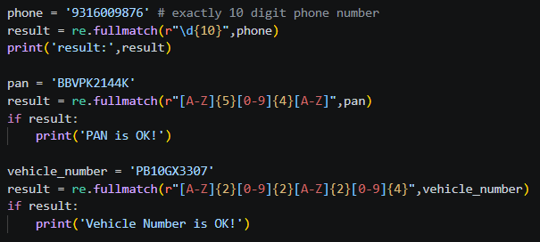
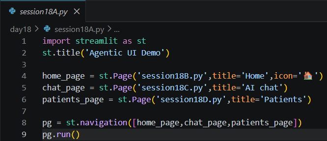
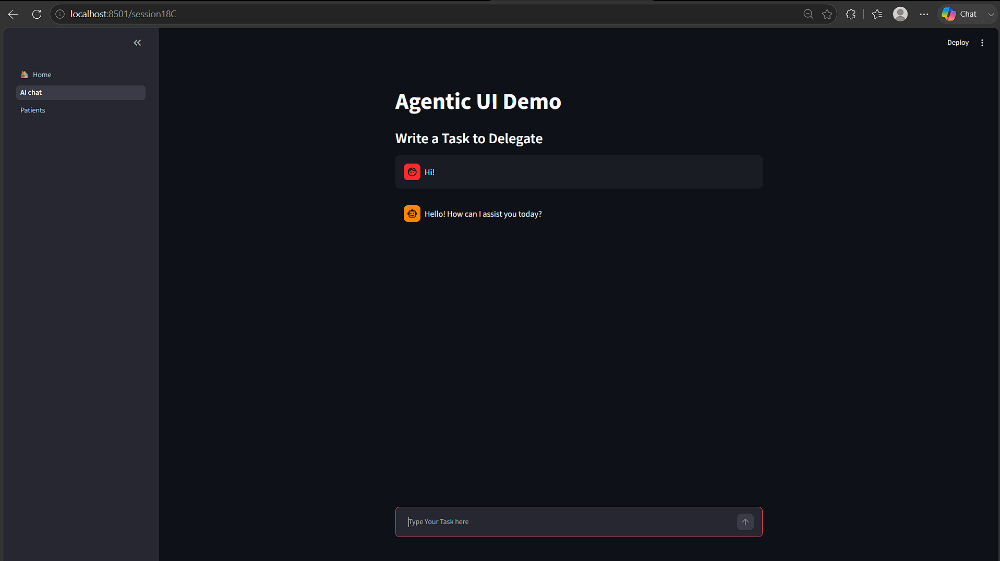
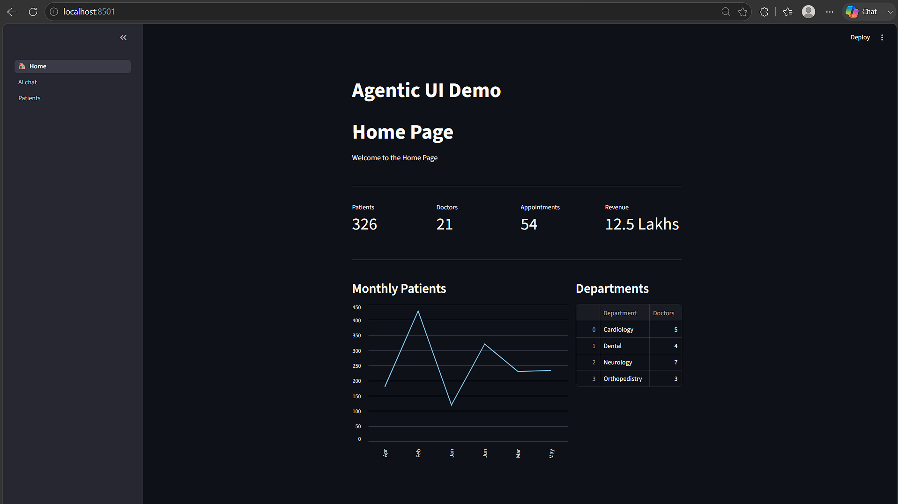

# Day 18 Assignment - Regex Validation and Multi-Page AI Task Manager

## 🎯 Objective

No separate assignment was given for this session. The practical work was to use regular expressions for text extraction and validation, and to build a multi-page Streamlit application that includes an AI-powered task manager.

---

# 📝 Problem Statement

## Part 1 - Regex

- Validate a 10-digit phone number, a PAN number and a vehicle registration number.
- Extract the phone number, email and vehicle number from one sentence.

## Part 2 - Multi-Page App

- Create a Streamlit app with a **Home** dashboard, an **AI chat** page and a **Patients** page.
- In the AI chat page, let the user create, list, update and delete tasks in natural language.

---

# 💡 Approach

## Part 1

- Use `re.fullmatch()` with a pattern for each format.
- Join three patterns with `|` and use `re.findall()` to extract all details together.

## Part 2

- Register each file with `st.Page()` and combine them with `st.navigation()`.
- Build the dashboard with `st.metric()`, `st.columns()`, `st.line_chart()` and `st.dataframe()`.
- Put the OpenAI Function Calling task manager in the chat page and connect it to MongoDB using `DBHelper`.

---

# 🧠 Concepts Applied

- Regular Expressions (`search`, `findall`, `fullmatch`)
- Streamlit Navigation and Pages
- Dashboard Components
- pandas DataFrames
- OpenAI Function Calling
- MongoDB CRUD
- `@st.cache_resource` and Session State

---

# 📂 Logic

```
Regex

    Validate phone, PAN, vehicle number using fullmatch
    Extract phone, email, vehicle from text using findall


App

    Main file registers pages and runs navigation

    Home     -> metrics, line chart, department table
    AI chat  -> send message and tools to model
                run chosen function on MongoDB
                show reply with typing effect
    Patients -> table of patient records
```

---

# 📷 Output









---

# 📚 Learning Outcome

Through this assignment, I learned:

- Writing patterns for real-world formats.
- Structuring a Streamlit project into several pages.
- Presenting data with metrics, charts and tables.
- Combining the UI, the AI model and the database into one application.

---

# 🚀 Skills Practiced

- Text Processing
- Web Interface Development
- AI Application Development
- Database Integration
- Problem Solving

---

# 📌 Conclusion

The session showed how small tools like regex and a modular page structure support a larger intelligent application. By the end, the AI task manager worked as one page of a complete dashboard.
