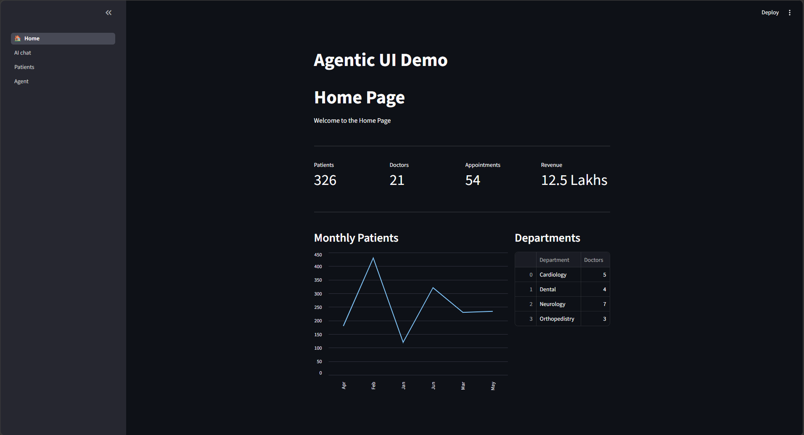
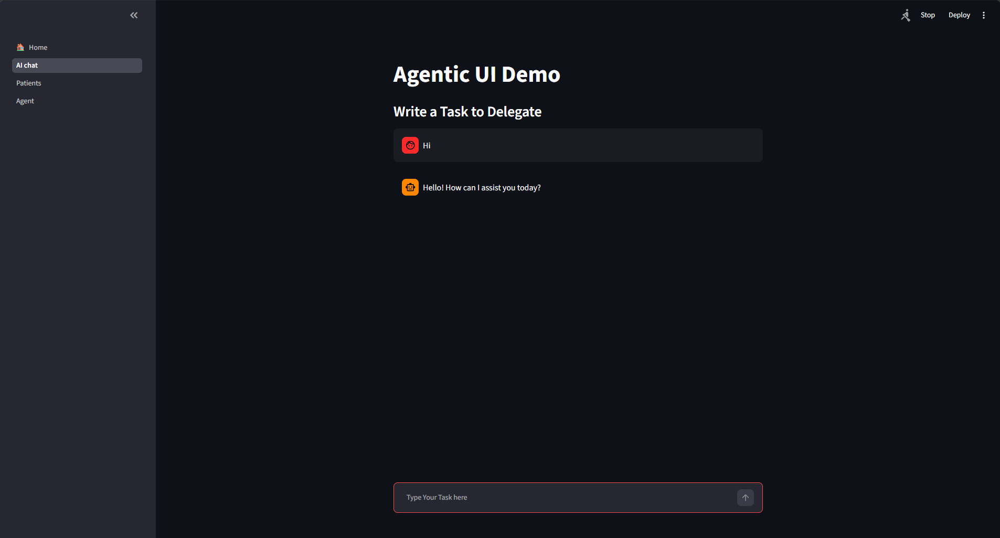
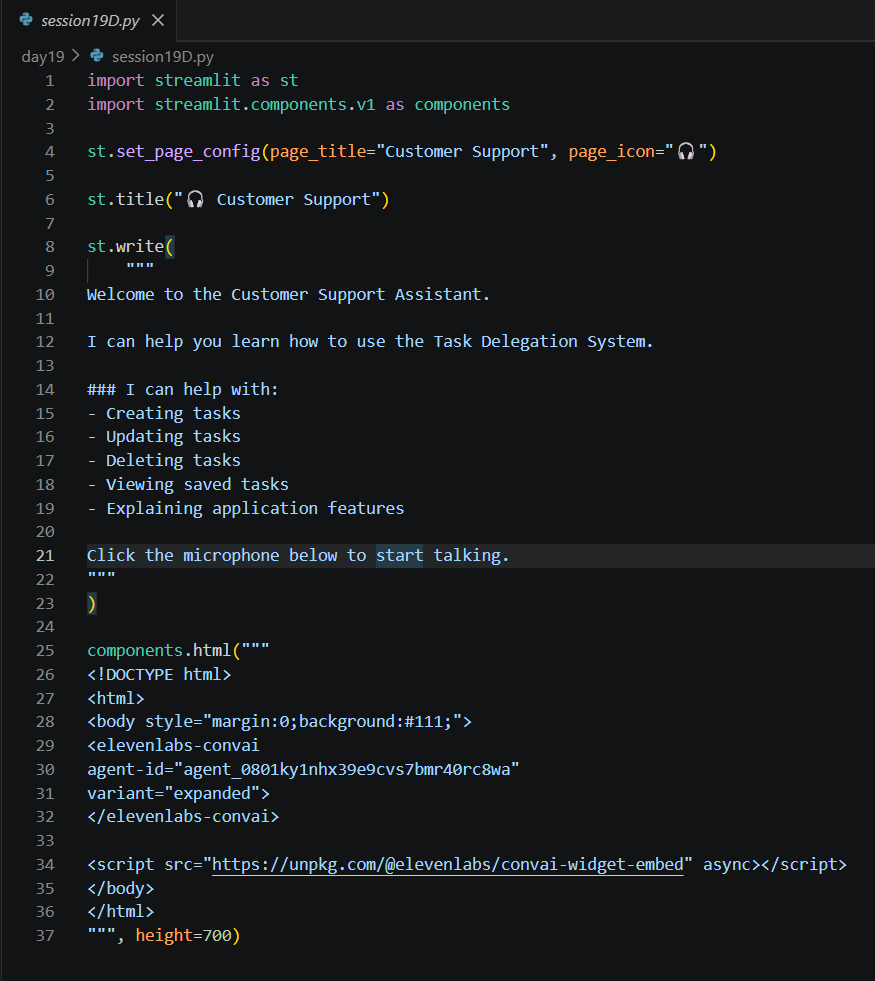
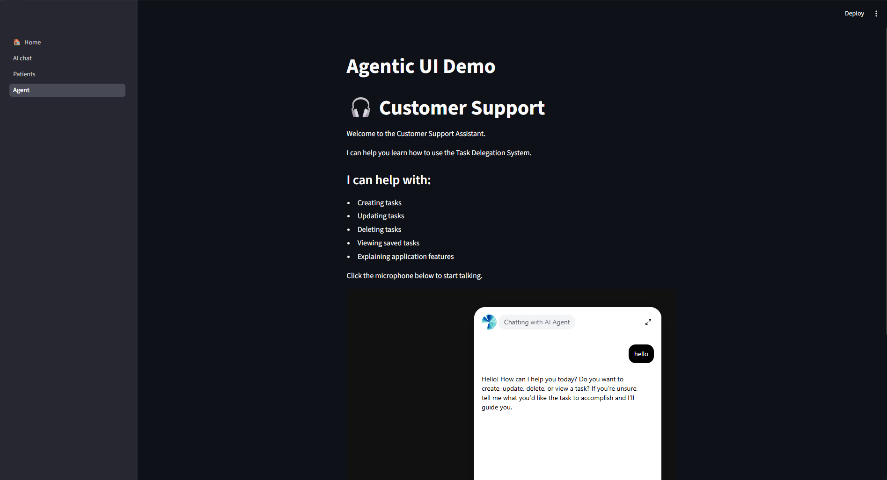

# Day 19 Notes

---

# Where We Are

Over the previous days the application gained these parts:

| Day | Added |
|-----|-------|
| 12-13 | MongoDB storage with `DBHelper` |
| 14 | Chat UI with CRUD commands |
| 15 | OpenAI Function Calling |
| 18 | Multi-page Streamlit app and dashboard |
| **19** | **Voice assistant using ElevenLabs** |

```
                  Streamlit (navigation)
     +--------+---------+-----------+-------------+
     |  Home  | AI Chat |  Patients | Voice Agent |
     +--------+---------+-----------+-------------+
                  |                        |
          OpenAI + MongoDB            ElevenLabs
```

---

# Multi-Page App with Four Pages

```python
import streamlit as st
st.title('Agentic UI Demo')

home_page     = st.Page('session19A.py', title='Home', icon='🏠')
chat_page     = st.Page('session19B.py', title='AI chat')
patients_page = st.Page('session19C.py', title='Patients')
voice_page    = st.Page('session19D.py', title='Agent')

pg = st.navigation([home_page, chat_page, patients_page, voice_page])
pg.run()
```

- This is the Day 18 structure with **one more page** (`voice_page`).
- Each page is its own file, so a page can be changed without touching the others.



---

# AI Chat Page (Task Management)

The AI chat page is unchanged from Day 18:

- The user writes a request in natural language.
- The OpenAI model picks `save_task`, `list_tasks`, `update_task` or `delete_task`.
- The function runs through `DBHelper` on the `tasks` collection in MongoDB.



---

# ElevenLabs Conversational AI

**ElevenLabs** provides voice AI. In its dashboard an **agent** is created and configured (its voice, instructions and behaviour). The agent receives a unique **Agent ID**.

A ready-made **widget** from ElevenLabs lets users talk to that agent from a web page.

---

# Embedding the Widget in Streamlit

```python
import streamlit as st
import streamlit.components.v1 as components

components.html("""
<!DOCTYPE html>
<html>
<body style="margin:0;background:#111;">
<elevenlabs-convai
    agent-id="YOUR_AGENT_ID"
    variant="expanded">
</elevenlabs-convai>

<script src="https://unpkg.com/@elevenlabs/convai-widget-embed" async></script>
</body>
</html>
""", height=700)
```

### How it works

| Part | Purpose |
|------|---------|
| `components.html(html, height=...)` | Shows raw HTML inside the Streamlit page |
| `<elevenlabs-convai>` | The custom HTML tag of the widget |
| `agent-id` | Selects **which** ElevenLabs agent to talk to |
| `variant="expanded"` | Shows the widget in its expanded form |
| `<script src=...>` | Loads the widget code from the ElevenLabs package |
| `height=700` | Height of the area in pixels |

The user clicks the microphone and talks; the agent answers in voice.

> The agent ID belongs to your own ElevenLabs account. Create your own agent and use its ID here instead of copying someone else's.



---

# Customer Support Page

The voice page is presented as a **Customer Support Assistant**.

```python
st.set_page_config(page_title="Customer Support", page_icon="🎧")
st.title("🎧 Customer Support")

st.write("""
Welcome to the Customer Support Assistant.

I can help you learn how to use the Task Delegation System.

### I can help with:
- Creating tasks
- Updating tasks
- Deleting tasks
- Viewing saved tasks
- Explaining application features

Click the microphone below to start talking.
""")
```

- `st.write()` accepts Markdown, so headings and bullet points can be written directly.
- The assistant explains how to use the application; it does not itself change the database.



---

# Database Integration

`DBHelper` still handles all MongoDB operations:

| Method | Operation |
|--------|-----------|
| `save()` | `insert_one()` |
| `retrieve()` | `find()` returned as a list |
| `update()` | `update_one()` with `$set` |
| `delete()` | `delete_one()` |

Because the database code lives in one class, the Streamlit pages and the AI layer stay independent of it.

---

# Class Activity

- Built a complete multi-page Streamlit application.
- Embedded the ElevenLabs voice widget.
- Connected the voice assistant with the Task Delegation application.
- Tested navigation between Home, AI Chat, Patients and the Voice Agent.

---

# Things to Revisit

- A page file reads its API key from a text file in a **different day's folder** (`day18/api_key.txt`). Paths should be checked when files are copied from one day to another.
- Keep API keys and database credentials out of the repository.
- The voice agent here only explains the system. Letting it perform task operations would need tools or webhooks configured on the ElevenLabs side.

---

# Project Milestone

The training now moves from separate examples to one real project. Starting from the next session, **Delegate AI** is built: an AI task delegation system combining OpenAI, MongoDB, Streamlit, Twilio and ElevenLabs. Later sessions add contact management, scheduling, AI calling agents and voice interactions.

---

# Summary

Today's session added a voice interface to the application by embedding an ElevenLabs Conversational AI widget in a four-page Streamlit app, and prepared the ground for the Delegate AI project.
