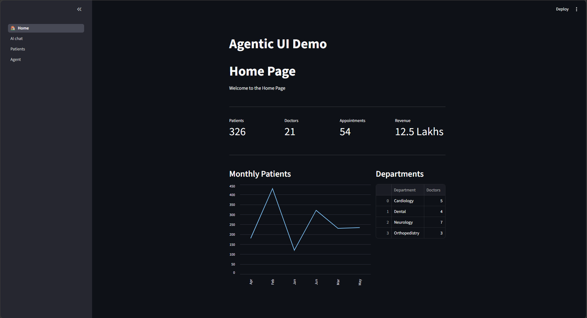
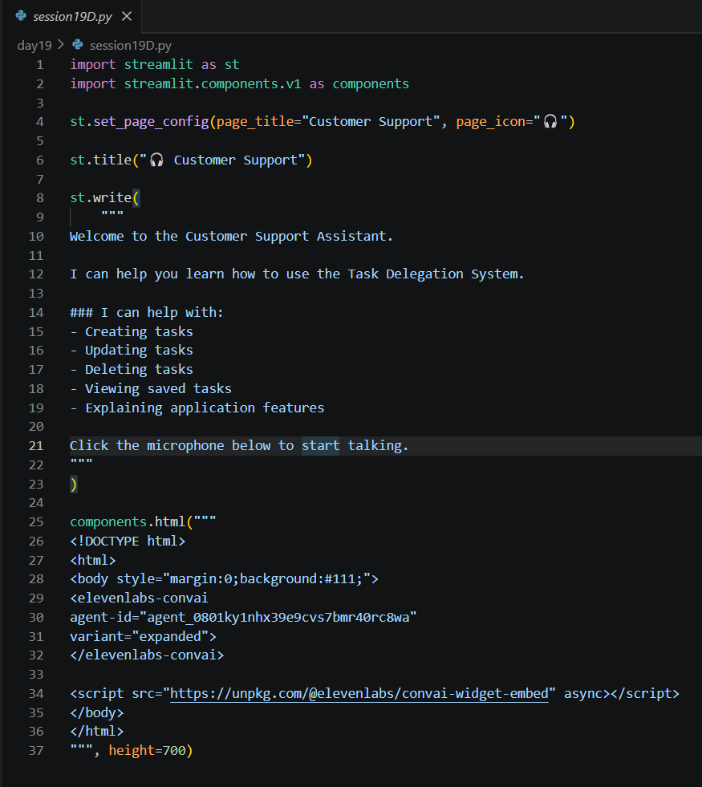
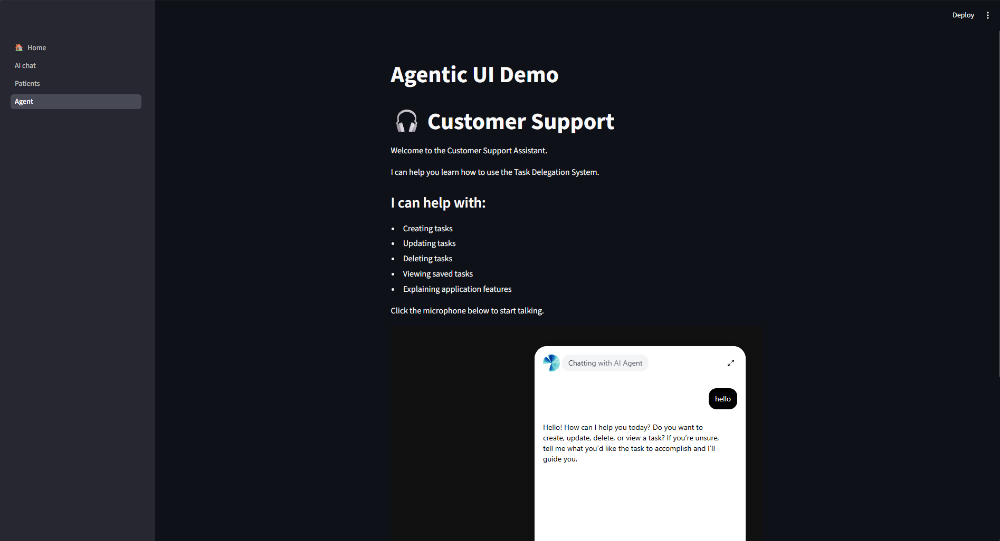

# Day 19 Assignment - Add a Voice Agent to the Task Application

## 🎯 Objective

No separate assignment was given for this session. The class task was to integrate an ElevenLabs voice agent into the existing Agentic AI Task Management application and test the complete workflow.

---

# 📝 Problem Statement

Extend the multi-page Streamlit application so that it:

- Has four pages: Home, AI Chat, Patients and Voice Agent.
- Keeps the AI chat that manages tasks through OpenAI Function Calling and MongoDB.
- Lets the user talk to a customer support assistant using an embedded ElevenLabs widget.

---

# 💡 Approach

- Create an agent in the ElevenLabs dashboard and note its Agent ID.
- Add a fourth page file for the voice agent.
- Register it with `st.Page()` and add it to `st.navigation()`.
- Embed the widget using `components.html()` with the `<elevenlabs-convai>` tag and the embed script.
- Add a short description of what the assistant can help with.
- Test navigation and every page.

---

# 🧠 Concepts Applied

- Streamlit Multi-Page Navigation
- Embedding HTML Widgets using `components.html()`
- ElevenLabs Conversational AI
- OpenAI Function Calling
- MongoDB CRUD through `DBHelper`

---

# 📂 Logic

```
Main file

    Register Home, AI Chat, Patients and Agent pages
    Run navigation

Agent page

    Show title and description
    Embed the ElevenLabs widget with the Agent ID

AI Chat page

    Message + tools -> model -> function -> MongoDB -> reply
```

---

# 📷 Output







---

# 📚 Learning Outcome

Through this assignment, I learned:

- How to add a voice interface to an existing application.
- How to embed a third-party widget in Streamlit.
- How several services (OpenAI, MongoDB, ElevenLabs) fit into one project.
- How to organize a larger project into separate page files.

---

# 🚀 Skills Practiced

- AI Application Development
- Third-Party Service Integration
- Web Interface Development
- Testing and Debugging

---

# 📌 Conclusion

Adding a voice agent showed how conversational interfaces can enhance an AI application with very little extra code, and completed the foundation needed to start the Delegate AI project.
