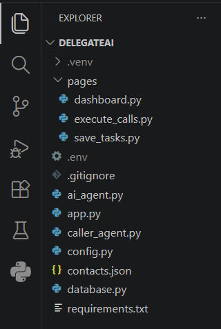
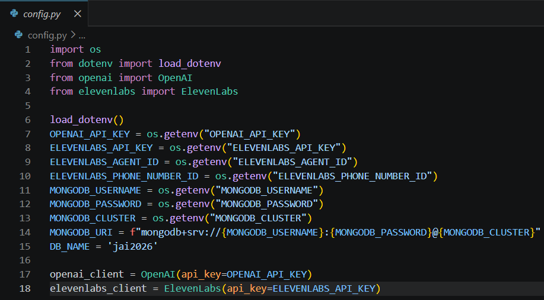
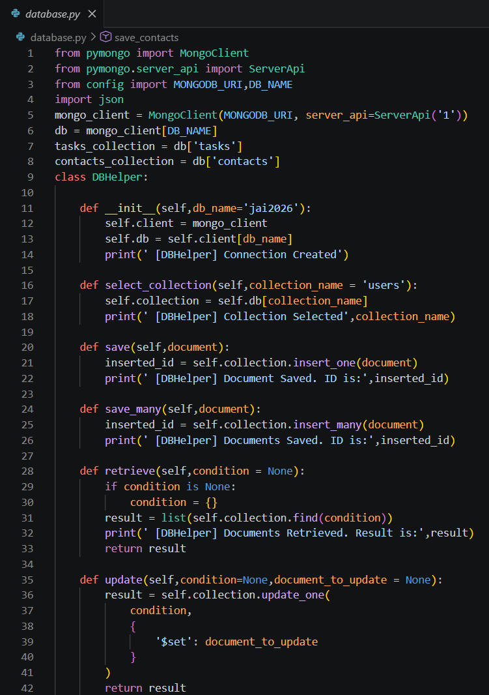
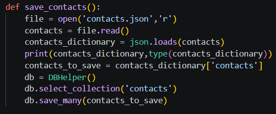

# Day 20 Notes

---

# Delegate AI

**Delegate AI** is the capstone project: an AI-powered task delegation system. The user gives a task in natural language, and the system saves it and, later, can contact the right person by calling them.

It combines everything learned so far:

| Technology | Role in the Project |
|------------|---------------------|
| OpenAI | Understands requests and chooses actions (Function Calling) |
| MongoDB Atlas | Stores tasks and contacts |
| Streamlit | User interface |
| ElevenLabs | Voice and AI calling agent |
| Twilio | Telephony (planned for later sessions) |

Planned features: contact management, task scheduling, AI calling agents, voice interactions and automation workflows.

---

# Project Directory

The application is **not** written in one big file. Each module has one responsibility.

```
delegate-ai/
├── .env                 # secrets (never pushed to GitHub)
├── contacts.json        # sample contacts
├── config.py            # settings and service clients
├── database.py          # DBHelper and contact import
├── ai.py                # AI processing (later sessions)
├── contacts.py          # contact management
└── calling.py           # calling functionality (later sessions)
```

Benefits of splitting the project:

- Each file is small and easy to understand.
- A bug is easier to locate.
- New features can be added as new modules.
- Several people can work on different files.



---

# Configuration (config.py)

```python
import os
from dotenv import load_dotenv
from openai import OpenAI
from elevenlabs import ElevenLabs

load_dotenv()

OPENAI_API_KEY = os.getenv("OPENAI_API_KEY")
ELEVENLABS_API_KEY = os.getenv("ELEVENLABS_API_KEY")
ELEVENLABS_AGENT_ID = os.getenv("ELEVENLABS_AGENT_ID")
ELEVENLABS_PHONE_NUMBER_ID = os.getenv("ELEVENLABS_PHONE_NUMBER_ID")
MONGODB_USERNAME = os.getenv("MONGODB_USERNAME")
MONGODB_PASSWORD = os.getenv("MONGODB_PASSWORD")
MONGODB_CLUSTER = os.getenv("MONGODB_CLUSTER")
MONGODB_URI = f"mongodb+srv://{MONGODB_USERNAME}:{MONGODB_PASSWORD}@{MONGODB_CLUSTER}"
DB_NAME = 'jai2026'

openai_client = OpenAI(api_key=OPENAI_API_KEY)
elevenlabs_client = ElevenLabs(api_key=ELEVENLABS_API_KEY)
```

### Step by step

1. `load_dotenv()` reads the `.env` file and puts its values into the environment.
2. `os.getenv("NAME")` reads one value; the secret is **not** in the source code.
3. The MongoDB connection string is built from its parts using an f-string.
4. The OpenAI and ElevenLabs clients are created **once** here, and other files import them.

### The .env file

```
OPENAI_API_KEY=...
ELEVENLABS_API_KEY=...
MONGODB_USERNAME=...
MONGODB_PASSWORD=...
```

- Add `.env` to `.gitignore` so it never reaches GitHub.
- Install the package with `pip install python-dotenv`.
- Use your **own** database name in `DB_NAME`.



---

# DBHelper (database.py)

```python
from pymongo import MongoClient
from pymongo.server_api import ServerApi
from config import MONGODB_URI, DB_NAME
import json

mongo_client = MongoClient(MONGODB_URI, server_api=ServerApi('1'))
db = mongo_client[DB_NAME]
tasks_collection = db['tasks']
contacts_collection = db['contacts']

class DBHelper:

    def __init__(self, db_name='jai2026'):
        self.client = mongo_client
        self.db = self.client[db_name]

    def select_collection(self, collection_name='users'):
        self.collection = self.db[collection_name]

    def save(self, document):
        self.collection.insert_one(document)

    def save_many(self, document):
        self.collection.insert_many(document)

    def retrieve(self, condition=None):
        if condition is None:
            condition = {}
        return list(self.collection.find(condition))

    def update(self, condition=None, document_to_update=None):
        return self.collection.update_one(condition, {'$set': document_to_update})

    def delete(self, condition):
        return self.collection.delete_one(condition)
```

### What changed from earlier days

| Before | Now |
|--------|-----|
| The connection string was written inside the helper | It is imported from `config.py` |
| A new client was made for every helper object | One shared `mongo_client` is reused |
| Only `save()` for one document | New `save_many()` using `insert_many()` |

| Method | MongoDB Call |
|--------|--------------|
| `save()` | `insert_one()` |
| `save_many()` | `insert_many()` (a list of documents) |
| `retrieve()` | `find()` converted to a list |
| `update()` | `update_one()` with `$set` |
| `delete()` | `delete_one()` |



---

# Contact Management

Before the AI can call someone, it needs a list of contacts.

### contacts.json

```json
{
  "contacts": [
    { "name": "...", "phone": "..." },
    { "name": "...", "phone": "..." }
  ]
}
```

The file holds a key `contacts` whose value is a **list of contact dictionaries**. Use your own sample names and numbers.

### Import function

```python
def save_contacts():
    file = open('contacts.json', 'r')
    contacts = file.read()
    contacts_dictionary = json.loads(contacts)
    print(contacts_dictionary, type(contacts_dictionary))
    contacts_to_save = contacts_dictionary['contacts']
    db = DBHelper()
    db.select_collection('contacts')
    db.save_many(contacts_to_save)
```

### Step by step

1. Open and read the JSON file (Day 11).
2. `json.loads()` converts the text into a Python dictionary (Day 11).
3. `contacts_dictionary['contacts']` picks the list of contacts.
4. Select the `contacts` collection.
5. `save_many()` inserts every contact in one call.

Why JSON? New contacts can be added or changed in the file without changing the code.



---

# Things to Revisit

- Running `save_contacts()` twice inserts the **same contacts again**, because `insert_many()` does not check for duplicates. Clear the collection or check before importing.
- Use `with open(...)` so the file is closed automatically (Day 11).
- Never push `.env`, API keys or database passwords to GitHub.

---

# Class Activity

- Created the Delegate AI project directory and source files.
- Installed all required Python dependencies.
- Configured OpenAI, ElevenLabs and MongoDB using environment variables.
- Implemented the reusable MongoDB helper class.
- Imported contact information from a JSON file into MongoDB Atlas.

---

# Next Session

The next session will build the user interface for Delegate AI and an AI-powered task manager with OpenAI Function Calling in a Streamlit chat interface.

---

# Summary

Today's session laid the foundation of Delegate AI: a modular project structure, secure configuration with environment variables, a reusable database helper, and contacts imported from JSON into MongoDB Atlas.
