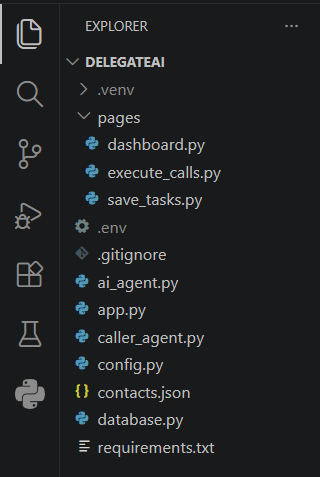
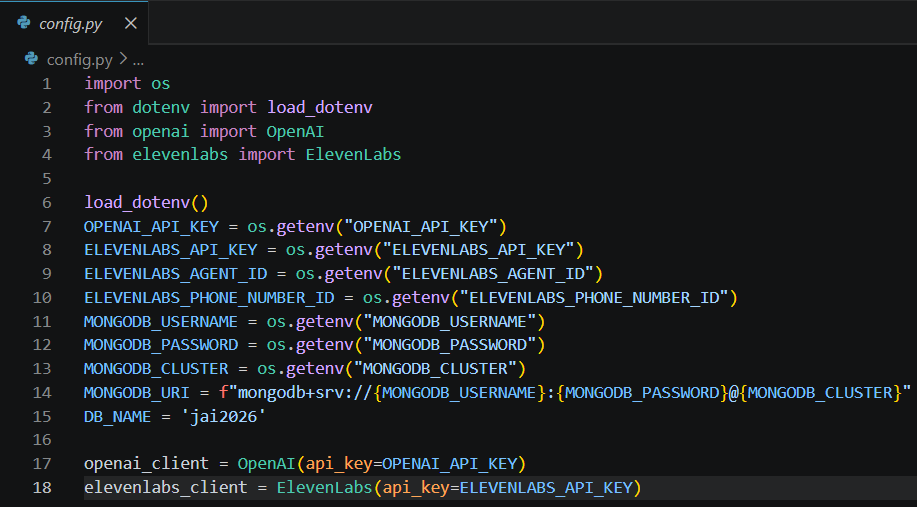
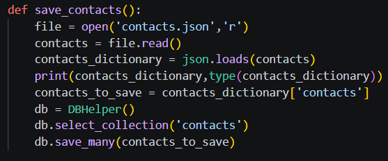

# Day 20 Assignment - Delegate AI Project Foundation

## 🎯 Objective

The objective of this assignment was to build the complete foundation of the Delegate AI project: the directory structure, the service configuration, the MongoDB connection and the contact import.

---

# 📝 Problem Statement

Build the foundation of Delegate AI by:

- Creating the project directory and its source files.
- Configuring OpenAI, ElevenLabs and MongoDB using environment variables.
- Connecting to MongoDB Atlas through a reusable helper class.
- Importing a list of contacts from a JSON file into the database.

---

# 💡 Approach

- Create one module for each responsibility (configuration, database, AI, contacts, calling).
- Keep every secret in a `.env` file and load it with `python-dotenv`.
- Create the OpenAI, ElevenLabs and MongoDB clients once in `config.py`.
- Write `DBHelper` with `save()`, `save_many()`, `retrieve()`, `update()` and `delete()`.
- Write `save_contacts()` to read `contacts.json`, parse it and insert all contacts into the `contacts` collection.
- Check the imported contacts in MongoDB Atlas.

---

# 🧠 Concepts Applied

- Modular Project Structure
- Environment Variables and `python-dotenv`
- Reusable Helper Classes
- MongoDB `insert_many()`
- JSON Reading and Parsing
- Separation of Configuration from Logic

---

# 📂 Logic

```
config.py

    Load .env
    Read keys and database details
    Create OpenAI, ElevenLabs and MongoDB clients

database.py

    Connect to MongoDB using the shared settings
    DBHelper -> select collection, save, save_many, retrieve, update, delete

    save_contacts()

        Read contacts.json
        Convert text into a dictionary
        Take the list under "contacts"
        Select the contacts collection
        Insert all contacts at once
```

---

# 📷 Output







(Add MongoDB Atlas `contacts` Collection Screenshot)

---

# 📚 Learning Outcome

Through this assignment, I learned:

- Organizing a real-world project into modules.
- Why configuration and secrets are kept outside the code.
- Building a database helper that the whole project can reuse.
- Loading starting data from a JSON file into a database.

---

# 🚀 Skills Practiced

- Software Project Structuring
- Secure Configuration
- Database Integration
- File and JSON Handling
- Problem Solving

---

# 📌 Conclusion

This assignment created the base on which all later Delegate AI features are built. A clean structure, safe configuration and a reusable database layer make it easy to add the task manager, scheduling and AI calling features in the following sessions.
